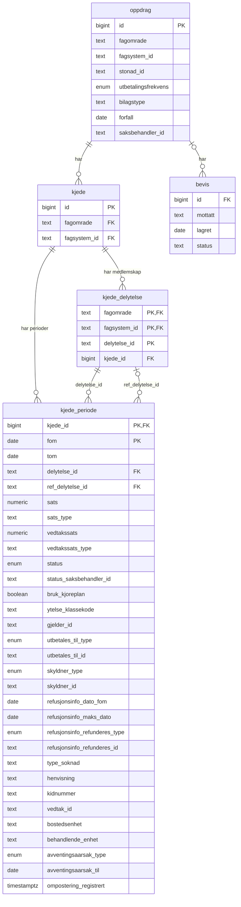
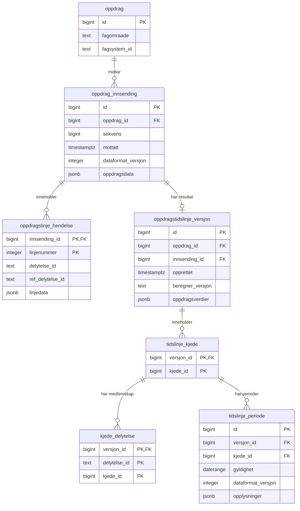
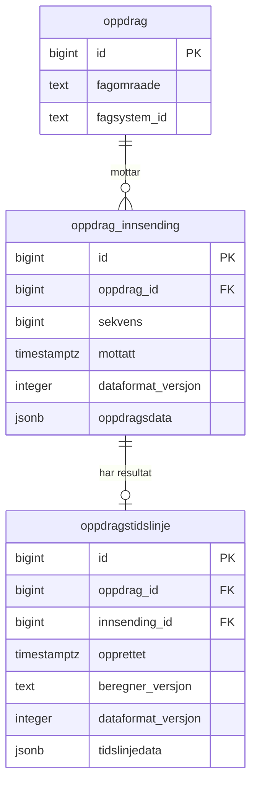
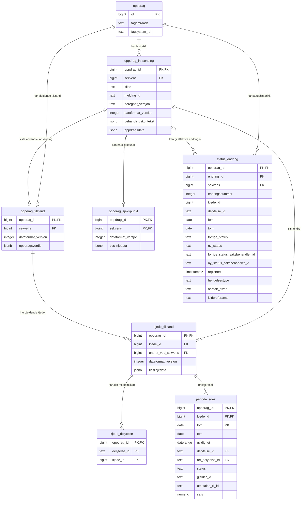

# Sammenligning av databasemodeller for oppdrag

## Antakelser
- Beregninger skjer på bakgrunn av siste versjon av et oppdrag. Vi gjør millioner av beregninger i uka, og det å hente ut siste versjon av et oppdrag må gå fort.
- Det er behov for å hente tidligere versjoner av et oppdrag for debugging og analyse av beregninger. Det er et lite volum av slike oppslag og følgelig akseptabelt at det tar tid  å produsere datagrunnlaget. Vi tror ikke vi har behov for å vise gamle versjoner av oppdrag i andre kontekster enn å se på en gammel beregning (?).
- Vi trenger å tilby lenker tilbake til vedtakssystemet
- Vi trenger å tilby informasjon om hvilke beregninger som er gjort på bakgrunn av et oppdrag.
- Vi trenger ikke å spore hvem som har gjort endringer som medfører at vi mottar nye oppdrag. Det er vedtakssystemets ansvar.
- Oppslag på oppdrag skjer på bakgrunn av nøkkel fra vedtakssystem eller intern id i økonomiseksjonen.
- Vi bør tilby informasjon om at et oppdrag venter på å bli beregnet dersom det er tilfelle.

## Moduler som grenser til mottak oppdrag
### Upstream

- vedtakssystemer/helved

### Downstream

- beslutningsmodul for beregninger. Denne modulen tar i mot informasjon om innkommende oppdrag, trekkvedtak eller skattekort og beslutter om og når en beregning skal skje (krever persistens). Denne komponenten holder oversikt over status i "venteregisteret" for beregninger og gir beregningskomponentene tilstrekkelig informasjon for beregning eller reberegning/korrigert beregning

## Ansvaret til mottak oppdrag

De 4 hovedoppgavene er:
1. Motta nytt oppdrag og persisterer det.
2. Motta endret oppdrag og persisterer det nye gyldige oppdraget.
3. Opsjonelt: Replay av tidligere mottatt og avvist oppdrag ved tolkningsfeil for å kunne persistere oppdraget på nytt.
4. ~~Simulere oppdrag.~~ Simulering av oppdrag produserer en beregning. Derfor tror vi simulerings-apiet går rett på beregnings-modulen.

Andre momenter:
- Motta, tolke og persistere oppdrag.
- Tilby nok informasjon til å kunne tilby pekere tilbake til vedtakssystemet.
- Validere oppdrag syntaktisk og semantisk. Vi vil avvise klassekoder som ikke er gyldige for fagområdet til et oppdrag. Vi vil avvise fagområder som ikke er kjent, eller som ikke hører til faggruppen til oppdraget.
- Trenger ikke forholde seg til beregninger eller beregningstatuser, men beregningsmodellen må tilbys en persistert peker for oppdragskjede/oppdragslinje som inngår i beregningen.
- Lagre bevis for mottak for debuggingformål. Lagres i råformatet, inklusive informasjon om hvorfor mottaket ble godtatt eller avvist, og om mulighet for re-sending.
- Tilby 10+1 års lagring av oppdrag. Vi har ikke lov til å tilby lagring av oppdrag ut over dette ihht GDPR? Innenfor denne perioden bør vi tilby å kunne vise alle versjoner av oppdrag vi har mottatt.
- Tilby 1 års tilgang til bevistabeller for debuggingsformål i AAP. Vi bruker bevistabellene som tekniske logger.
- Vi tror ikke vi trenger å migrere bevis for mottak av gamle oppdrag fra oppdragz, slik at vi kan migrere bare nå-tilstand for oppdrag fra oppdrag z. Det betyr  at vi mister muligheten
 til å vise frem gamle versjoner av oppdrag som er fra oppdragz-tiden. Dette er foreslått som en praktisk tilnærming til et tett prosjektløp.
- Forutsetter at beregningsdatabasen har tilstrekkelig informasjon for å utføre beregninger og korrigerte beregninger.

## Hvilke kriterier er viktige ved valg av modell?

- Mulighet for enkel resending av tidligere mottatt oppdrag som har blitt tolket feil? Dette innebærer også endring av persisteringen av oppdraget.
- Frikobling fra dagens mottaks-api? Det er ønskelig med et enklere og mer restriktivt API som ikke har avhengigheter til dagens mottaks-api.
- Mulighet for endring og forbedring av persistensmodell for oppdrag? Erfaringer fra verifikasjon i test/prod kan resultere i at eksisterende modell må videreutvikles.
- YtelseKrav til rekonstruksjon av tidligere mottatt oppdrag? Dersom behovet for å analyserer eldre oppdrag og tilknyttede beregninger er forholdsvis lavt, kan kravet til responstid for presentasjon være lavt.
- Vi skal ikke ha nedetid dersom vi oppgraderer mottak av oppdrag til å arbeide med en forbedret datamodell. Det er ok å kreve bakoverkompatible endringer slik at forrige versjon av applikasjonen kan fortsette å kjøre under oppgradering, ref Sadalage/Ambler: Database refactoring eller databaserefactoring.com
- Databasen til oppdrag z bruker ikke fremmednøkler. Vi ønsker et databasedesign der vi bedre ivaretar referensiell integritet.
- Vi skal ikke bruke nøkler eid av andre systemer til å bygge relasjoner i våre databaser, slik at sammenhengen i vår databasemodell ikke er avhengig av implementasjonen av f.eks. vedtakssystemer. Vi er nødt til å lagre eksterne nøkler for oppslag.
- Teamet ser to veier videre: Vi kan lagre oppdraget som et dokument i databasen (jsonb-format), eller vi kan lage et relasjonelt design.

## Kort oppsumering av modellene

- Alle modellene benytter en egen bevis-tabell som holder informasjon om rådataene som ble mottatt og om oppdraget er godkjent eller avvist (med begrunnelse). Det er viktig at dette er formatet til systemet som sender.
- Modell 1 passer som en relasjonell lagring av gjeldende tilstand.
- Modell 2 passer bedre hvis løsningen ofte skal søke i enkeltlinjer og perioder direkte med SQL.
- Modell 3 passer når koden håndterer constraints og mottaksregler for oppdraget og dokumentstørrelsene er håndterbare.
- Modell 4 skiller innsendingshistorikk, gjeldende tilstand per kjede, periodiske sjekkpunkter og søkeprojeksjoner. Det reduserer behovet for å lagre en full kopi av alle kjeder etter hver innsending.
- Vi ønsker ikke å bruke identifikatorer laget av eksterne systemer når vi lagrer oppdrag, eller peker på oppdrag fra andre beregningsmotor-objekter. Vi ønsker å kunne bytte ut vedtakssystemer uten at dette berører vår datamodell dypt.

## Hva modellene skal representere

Modellene presentert tar utgangspunkt i pakken `no.nav.utbetaling.beregning.oppdrag` som skiller mellom innsendte oppdrag og den sammenslåtte tidslinjen. Flere innsendinger kan endre samme oppdrag. 
Kotlin-koden grupperer linjer i kjeder og avgjør hvilke opplysninger som gjelder i hver periode.

Følgende oppdrag-egenskaper skal bevares ved lagring:

- Et oppdrag identifiseres i forhold til fagsystemet av kombinasjonen `fagområde` og `fagsystemId`.
- Vi identifiserer oppdrag med en bigint eller en versjon 7 uuid. Uuid tar dobbelt så stor plass som en bigint, og vi må følge med på lagrings- og minnebehov dersom vi velger å øke størrelsen på identifikatorene. Databasen til oppdrag z tar 3 TB med lagring.
- Kjeder har et sett med delytelse-ID-er, også ID-er som ikke lenger er synlige i periodene. Disse ID-ene eies av fagsystemet.
- En periode har en startdato og eventuelt en sluttdato. Sluttdatoen er inklusiv.
- Opphørte perioder har status og opplysninger. Opphør betyr ikke at perioden skal slettes.

## Oversikt

| Egenskap | Modell 1 | Modell 2 | Modell 3 | Modell 4 |
|---|---|---|---|---|
| Antall tabeller | 4 | 7 | 3 | 8 |
| Formål | Gjeldende sammenslått tilstand | Innsendingshistorikk og versjonerte tidslinjer | Innsendingshistorikk og versjonerte tidslinjer | Innsendingshistorikk, gjeldende tilstand, statushistorikk og periodiske sjekkpunkter |
| Domenefelter | Typede kolonner | Blanding av kolonner og JSONB | Hovedsakelig JSONB | JSONB for oppdrags- og kjedeverdier, typede kolonner i søkeprojeksjoner og `status_endring` |
| Innsendte linjer | Ikke lagret som historikk | Én rad per linjeforekomst | Ordnet array i innsendingens JSON | Ordnet array i innsendingens JSON |
| Perioder | Én rad per periode | Én rad per periode og versjon | Inne i tidslinjens JSON | I kjedens JSON, med utvalgte felt som rader i `periode_soek` |
| Kjedemedlemskap | Egen tabell | Egen tabell per versjon | Må inngå i JSON-kontrakten | Egen tabell for gjeldende medlemskap; komplett medlemskap må også inngå i sjekkpunkter |
| Kontroll av periodeoverlapp | PostgreSQL | PostgreSQL | Kotlin | Kotlin |
| Kontroll av innsendte linjereferanser | Utenfor modellens formål | Delvis håndhevet med unike indekser | Kotlin | Kotlin |
| SQL-søk på domenefelter | Direkte kolonneoppslag | Kolonneoppslag og JSON-søk | JSON-søk eller egne søkeprojeksjoner | Kolonneoppslag i søkeprojeksjoner og `status_endring`, JSON-søk på øvrige felt |
| Søk i historiske statusendringer | Ingen historikk | Kan utledes fra versjonerte perioder | Krever JSON-sammenligning eller gjennomspilling | Direkte søk i `status_endring` |
| Tilpasning ved modellendring | Ofte SQL-migrering | Avhenger av hvilket felt som endres | Ofte ny JSON-formatversjon | Ny JSON-formatversjon og eventuelt SQL-migrering av søkeprojeksjoner |

## Modell 1: relasjonell lagring av gjeldende tilstand

SQL-filen bruker PostgreSQL-schemaet `oppdrag`. Diagrammet viser et utvalg av kolonnene. `PK` markerer primærnøkkel og `FK` fremmednøkkel. Når flere kolonner er merket `PK` i samme tabell, utgjør de én sammensatt primærnøkkel.

Denne modellen lagrer bare siste versjon av et oppdrag, ferdig organisert for å være enkelt å bruke for å lage beregninger.

Fremvisning av eldre versjoner av et oppdrag gjøres ved å hente frem data fra bevistabellen, frem til en gitt dato. Dette brukes til å lage et ikke-persistert oppdrag, som så sendes til frontend for fremvisning. Vi tror dette
er en så lite brukt funksjon at vi ikke har tenkt videre på om ytelsen kommer til å være rask nok, men det er helt klart mulig å cache tidligere versjoner av oppdrag dersom det er regningssvarende mtp lagringsplass
og utviklingstid.



Begge ID-referansene fra `kjede_periode` er sammensatte fremmednøkler sammen med `kjede_id`. De sikrer at ID-ene tilhører samme kjede som perioden. `ref_delytelse_id` er valgfri. En GiST-eksklusjonsregel hindrer overlappende perioder i samme kjede.

### Livssyklus på databasedesign

Databasen vedlikeholdes med flyway-skript, og databasen inneholder oppdrag i versjonen som støttes av siste kjørende versjon av beregningsplattformen. Endringer av databasen må være bakoverkompatible 
med forrige versjon av databasen, ref Ambler/Sadalage: Database Refactoring. Vi garanterer ikke at databaseskjema versjon N-2 fungerer.

Vi foreslår at vi ikke tilbyr flyway-skript for å gå tilbake i database-versjoner som en praktisk tilpasning til en kort prosjektperiode. Vi tar mål av oss til å teste alle databasemigreringer
automatisk, og foreslår at rest-risikoen spises av prosjektet. Det er også vanskelig å teste tilbakerullings-skript godt nok, så verdien ved å tilby slike skript er ofte mindre enn man håper.

### Fordeler

- Databasen håndhever mange regler for datakvalitet.
- Typede kolonner gjør SQL-søk, summeringer og rapportering enklere, uten å lese et helt JSON-dokument.
- Egne medlemskapsrader i kjede_delytelse bevarer også overskrevne delytelseID-er.
- Oppdateringer krever ikke en ny fullstendig historisk kopi av tidslinjen.
- Strukturen ligger nær den eksisterende relasjonelle databasen og kan redusere omfanget av migreringen.


### Ulemper

- Modellen lagrer verken opprinnelige innsendinger eller tidligere versjoner av tidslinjen. Den kan ikke alene brukes til å spille av historikken.
- Persistenskoden må oversette mange kolonner til og fra kotlin-typene.
- Endringer i domenemodellen kan kreve endringer i både kolonner, enum-typer og databaseregler. 

Modell 1 er aktuell hvis et annet system allerede lagrer den autoritative innsendingshistorikken, eller hvis SQL-tilgang til gjeldende tilstand er hovedbehovet.

## Modell 2: historikk med relasjonelle linjer og perioder

Modell 2 lagrer opprinnelige linjeforekomster og beregnede tidslinjeversjoner i separate tabeller. Oppdragets øvrige input, oppdragsverdier og periodeopplysninger ligger i JSONB.



Resultatet peker til innsendingen med en sammensatt fremmednøkkel på `(oppdrag_id, innsending_id)`. Den sikrer at resultatet tilhører riktig oppdrag. Tilsvarende bruker medlemskap og perioder `(versjon_id, kjede_id)` for å peke til riktig kjedeversjon.

### Livssyklus

Databasen lagrer forskjellige versjoner av oppdrags-objektet, identifisert med dataformat_versjons-feltet. Vi kan ikke slette en utdatert dataformat-versjon før den ikke eksisterer i databasen lenger. Vi må ta frem regler for hvordan dette skal skje.

### Fordeler

- `sekvens` bevarer rekkefølgen mellom innsendinger, og `linjenummer` bevarer rekkefølgen inne i hver innsending.
- Gjentatte delytelse-ID-er kan lagres uten at linjeforekomster forsvinner.
- Partielle unike indekser håndhever at høyst én forekomst per delytelseID har en refDelytelseID i innsendingen, og at flere refererende linjer ikke peker til samme ID.
- Databasen hindrer overlappende perioder innenfor samme kjedeversjon.
- Linjer, medlemskap og perioder kan søkes opp uten å lese hele tidslinjedokumentet.

### Ulemper

- Sju tabeller gir flere skriveoperasjoner og mer kode for å sette sammen et komplett oppdrag.
- Fullstendige tidslinjeversjoner gjentar uendrede medlemskap og perioder ved hver innsending.
- JSONB-feltene trenger fortsatt en definert struktur og validering i applikasjonen.
- ID-ene inne i `opplysninger` har ingen fremmednøkkel til `kjede_delytelse`.
- JSON-dokumentet `oppdragsverdier` har ingen egen formatversjon. Denne kontrakten må avklares.

Modell 2 passer når det er viktig å kombinere historikk med direkte SQL-søk på linjer eller datointervaller.

## Modell 3: innsendinger og tidslinjer som JSONB-dokumenter

Modell 3 beholder oppdragsidentitet og innsendingsrekkefølge i kolonner. Alle linjer ligger i `oppdragsdata`, mens kjeder og perioder ligger i `tidslinjedata`.



Også her sikrer den sammensatte fremmednøkkelen at resultat og innsending tilhører samme oppdrag. 

Databasen krever at `oppdragsdata` inneholder arrayet `oppdragsLinje150`. Den krever også at `tidslinjedata` inneholder objektet `oppdragsverdier` og arrayet `kjeder`. Den kontrollerer ikke innholdet i arrayene.

### Livssyklus

Databasen lagrer forskjellige versjoner av oppdrags-objektet, identifisert med dataformat_versjons-feltet. Vi kan ikke slette en utdatert dataformat-versjon før den ikke eksisterer i databasen lenger. Vi må ta frem regler for hvordan dette skal skje i praksis.

### Fordeler

- Lagringsformen passer arbeidsflyten «les oppdrag, behandle i kotlin, lagre ny tilstand».
- Innsendingens JSON-array bevarer linjerekkefølge og gjentatte ID-er.
- Hele tidslinjen kan lagres i én resultatrad uten å opprette separate rader for hver periode.
- Begge dokumenttypene har `dataformat_versjon`, slik at applikasjonen kan skille mellom eldre og nyere lagringsformater.

### Ulemper

- Fullstendige snapshots gjentar uendret tilstand ved hver innsending.
- Kotlin må kontrollere linjereferanser, kjedemedlemskap og periodeoverlapp.
- Store tidslinjer kan gi store dokumenter og høye kostnader ved lesing, skriving og indeksering.
- SQL-søk på enkeltperioder og domenefelter krever JSON-uttrykk.
- JSON-kontrakten må utvikles og vedlikeholdes. Lagring av vilkårlige objekter uten formatstyring er ikke tilstrekkelig.

## Modell 4: per-kjede-JSONB, statushistorikk og periodiske sjekkpunkter

### Tabeller og ansvar

| Tabell | Innhold og levetid |
|---|---|
| `oppdrag` | Stabil identitet og rad som låses ved behandling av ett oppdrag |
| `oppdrag_innsending` | Én historisk rad per anvendt innsending, med ordnet input, meldingsidentitet, kodeversjon og behandlingskontekst |
| `oppdrag_tilstand` | Ett sett med gjeldende oppdragsverdier og siste anvendte sekvens per oppdrag |
| `kjede_tilstand` | Ett gjeldende JSONB-dokument per kjede, med perioder og siste sekvens som endret kjeden |
| `kjede_delytelse` | Hele det gjeldende ID-settet, også refererte og fullstendig overskrevne ID-er |
| `oppdrag_sjekkpunkt` | Sporadiske, komplette kopier av oppdragets tilstand for historisk rekonstruksjon |
| `periode_soek` | Typede søkefelter fra gjeldende perioder, ikke historiske kopier av alle perioder |
| `status_endring` | Uforanderlige, typede rader for effektive statusendringer og eventuelle importerte startobservasjoner |



### Direkte søk i statusendringer

`status_endring` gjør det mulig å finne hvilke statuser som ble endret, hvilke perioder endringene gjelder, og hvilken innsending som utløste dem.

Kotlin-koden kan endre status på linje- og oppdragsnivå og unnta bestemte delytelse-ID-er. Originalinstruksjonen, med omfang og unntak, bevares i innsendingen. `status_endring` beskriver det faktiske resultatet for hver berørt delytelse og periode etter at disse reglene er anvendt.

### Livssyklus

Databasen lagrer forskjellige versjoner av oppdrags-objektet, identifisert med dataformat_versjons-feltet. Vi kan ikke slette en utdatert dataformat-versjon før den ikke eksisterer i databasen lenger. Vi må ta frem regler for hvordan dette skal skje.

### Fordeler

- Bare endrede kjeder må lagres på nytt, ikke hele oppdragets tilstand.
- Fullstendige historiske kopier blir begrenset til sjekkpunkter.
- Medlemstabellen bevarer hele ID-settet.
- Meldingsidentitet støttet idempotens innenfor oppdrag og kilde.
- Typede søkeperioder og målrettet GIN begrenser behovet for JSON-søk i hele historikken.
- Statusendringer kan søkes opp direkte med SQL uten å sammenligne JSON-dokumenter eller spille gjennom innsendinger.

### Ulemper og nødvendige endringer

- En endret periode kan fortsatt kreve omskriving av et stort kjededokument.
- JSONB og søkeprojeksjoner krever atomiske oppdateringer for å holde innholdet konsistent.
- Eksisterende relasjonelle data må omformes til JSONB og deretter delvis gjenskapes som søkeprojeksjoner.
- `status_endring` gir ekstra rader og indeksvedlikehold.

Historikk, idempotens og periodiske sjekkpunkter er nyttige prinsipper i modell 4.


### Hash-partisjonering og indekser

De åtte tabellene som tilhører et oppdrag, inkludert `status_endring`, er hash-partisjonert på `oppdrag_id`. Alle primærnøkler, unike nøkler og refererte nøkler inkluderer partisjoneringsnøkkelen. Identitetstabellen `oppdrag` er ikke partisjonert og håndhever den globale forretningsnøkkelen `(fagomraade, fagsystem_id)`.

Oppslag med `oppdrag_id` kan avgrenses til én partisjon per tabell. Globale søk på person eller mottaker må vanligvis besøke alle partisjonene. 

For bare delytelse-ID er et oppslag i `kjede_delytelse` enklere og omfatter også overskrevne ID-er. GIN-indeksen er aktuell for andre kombinasjoner av periodefelter som ikke finnes i søkeprojeksjonen. 

For statushistorikk er en B-tree-indeks på `(oppdrag_id, delytelse_id, sekvens, endringsnummer)` et utgangspunkt for oppslag på én delytelse og registreringsrekkefølge.

## Forhold som må avklares før bruk

### Skill rekkefølge fra versjon

| Felt | Betydning |
|---|---|
| `sekvens` | Rekkefølgen innsendingene skal behandles i innenfor ett oppdrag |
| `linjenummer` i Modell 2 | Rekkefølgen på linjene i én innsending |
| `dataformat_versjon` | Hvilken kontrakt applikasjonen skal bruke for å lese JSON |
| `beregner_versjon` | Hvilken implementasjon som produserte resultatet |

### Definer transaksjoner og ny behandling

For Modell 2 og 3 bør innsending og ferdig resultat lagres atomisk. Lås oppdraget før gjeldende tilstand leses og endres, eller bruk en tilsvarende strategi som oppdager samtidige oppdateringer.

Ingen av de tre opprinnelige forslagene definerer transportbasert idempotens. Modell 4 legger til kilde og meldingsidentitet per oppdrag. Mottaket må kunne gjenkjenne en melding som leveres på nytt.

## Indekser og ytelse

Modell 1 og 2 har GiST-eksklusjonsregler som hindrer periodeoverlapp. Modell 2 og 3 har B-tree-indekser gjennom unikhetsregelen på `(oppdrag_id, sekvens)`. Ingen av de tre SQL-filene definerer GIN-indekser.

For Modell 3 kan en målrettet indeks støtte søk i innsendte linjer:

```sql
CREATE INDEX oppdrag_innsending_linjer_gin
    ON oppdrag_innsending
    USING gin (
        (oppdragsdata -> 'oppdragsLinje150') jsonb_path_ops
    );
```

```sql
SELECT id, oppdrag_id, sekvens
FROM oppdrag_innsending
WHERE (oppdragsdata -> 'oppdragsLinje150')
    @> '[{"delytelseId": "123", "kodeStatusLinje": "OPPH"}]'::jsonb;
```

GIN passer til innholdssøk i dokumenter og arrayer. B-tree passer vanligvis bedre til likhet på enkeltverdier, intervallsøk og sortering. En GIN-indeks gir ikke resultatene i ønsket sorteringsrekkefølge og kan bli stor når mange historiske dokumenter inneholder de samme verdiene.

Velg indekser ut fra de faktiske søkene. Mål komplette spørringer med `EXPLAIN (ANALYZE, BUFFERS)` på representative data.
